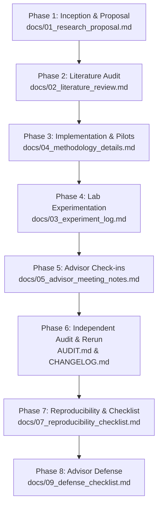

# Research Lifecycle & Documentation Index

Welcome to the project documentation index for the research study:
**"Baseline-Evaluation Coupling in Integrated Gradients for Text: A Cross-Evaluation Study and Analysis of Ensemble Baselines"**

This folder contains the complete formal paper documentation, lab notebooks, meeting logs, and defense materials following academic best practices (The Turing Way, Open Science Framework, and ACL/NeurIPS Reproducibility Standards).

---

## 🗺️ Research Lifecycle Roadmap

Every step from the initial research idea to the final camera-ready revision is tracked chronologically and conceptually:

---

## 📂 Document Catalog

| Document | Purpose & Description | Target Audience |
|---|---|:---:|
| [`01_research_proposal.md`](file:///c:/Users/91798/OneDrive/Desktop/Research/project/docs/01_research_proposal.md) | Initial research grant/proposal submitted to advisor: research questions (RQ1–RQ3), hypotheses (H1–H3), experimental design, resource requirements, and 8-week timeline. | Advisor, Thesis Committee |
| [`02_literature_review.md`](file:///c:/Users/91798/OneDrive/Desktop/Research/project/docs/02_literature_review.md) | Rigorous literature survey on axiomatic attribution, baseline selection in NLP, faithfulness metrics (ERASER), and out-of-domain erasure artifacts. | Reviewers, Lab Members |
| [`03_experiment_log.md`](file:///c:/Users/91798/OneDrive/Desktop/Research/project/docs/03_experiment_log.md) | Chronological lab notebook detailing all 11 experimental milestones, parameter configurations, runtime observations, and code fixes. | Auditors, Future Self |
| [`04_methodology_details.md`](file:///c:/Users/91798/OneDrive/Desktop/Research/project/docs/04_methodology_details.md) | Technical implementation specs: Riemann sum quadrature, probability output space integration, attention mask handling under PAD, logit-space Grad×Input, and LMM formula. | Reproducibility Reviewers |
| [`05_advisor_meeting_notes.md`](file:///c:/Users/91798/OneDrive/Desktop/Research/project/docs/05_advisor_meeting_notes.md) | Meeting agendas, advisor feedback, directional decisions, and action items across 6 weekly supervision sessions. | Advisor, Student |
| [`06_data_dictionary.md`](file:///c:/Users/91798/OneDrive/Desktop/Research/project/docs/06_data_dictionary.md) | Complete schema and variable definitions for all raw CSV files, JSON outputs, and ablation datasets. | Data Scientists, Reviewers |
| [`07_reproducibility_checklist.md`](file:///c:/Users/91798/OneDrive/Desktop/Research/project/docs/07_reproducibility_checklist.md) | Official ACL/NeurIPS Responsible Research Checklist with direct section and line pointers. | Conference Reviewers |
| [`08_reproduction_guide.md`](file:///c:/Users/91798/OneDrive/Desktop/Research/project/docs/08_reproduction_guide.md) | Step-by-step terminal commands to reproduce all experiments, statistical analyses, figures, and Overleaf packages from scratch. | Any Researcher |
| [`09_defense_checklist.md`](file:///c:/Users/91798/OneDrive/Desktop/Research/project/docs/09_defense_checklist.md) | Comprehensive defense briefing: elevator pitch, claim-by-claim statistical proof, tough questions & answers, and live demonstration commands. | Student, Defense Committee |

---

## 🔍 How to Use This Documentation

1. **For Advisor Meetings:** Open [`05_advisor_meeting_notes.md`](file:///c:/Users/91798/OneDrive/Desktop/Research/project/docs/05_advisor_meeting_notes.md) and [`09_defense_checklist.md`](file:///c:/Users/91798/OneDrive/Desktop/Research/project/docs/09_defense_checklist.md) to walk through progress, decisions, and statistical evidence.
2. **For Re-running Code:** Follow the commands in [`08_reproduction_guide.md`](file:///c:/Users/91798/OneDrive/Desktop/Research/project/docs/08_reproduction_guide.md).
3. **For Conference Submission:** Attach [`07_reproducibility_checklist.md`](file:///c:/Users/91798/OneDrive/Desktop/Research/project/docs/07_reproducibility_checklist.md) and upload the ready-made [`overleaf_paper.zip`](file:///c:/Users/91798/OneDrive/Desktop/Research/overleaf_paper.zip).
